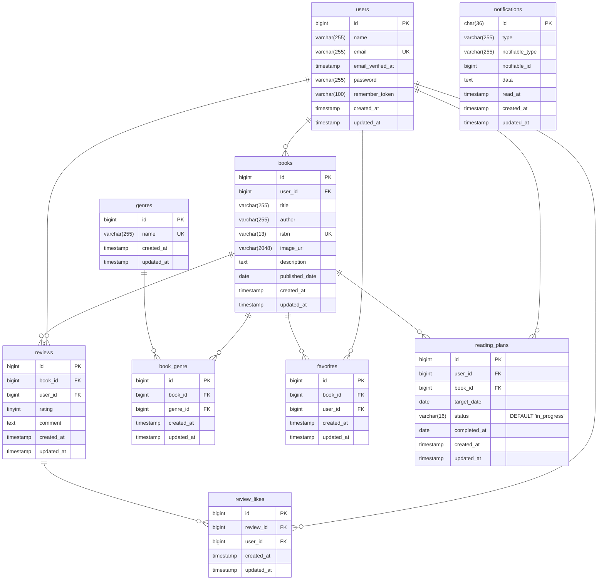

# BookShelf 書籍レビューアプリ
## 書籍を登録し、レビューを共有するアプリケーションです。以下の操作が可能です。
- 書籍を登録(Google Books APIsを使用した書籍のISBN検索、自動入力対応)
- 書籍一覧・詳細閲覧
- 書籍のレビュー投稿、レビューに対するいいね登録
- 書籍のお気に入り登録
- レビュー評価点数ごとの書籍のランキング表示
- 書籍に対する自身のレポート表示
- 書籍のAPI操作(閲覧・登録・更新・削除)
- 読書計画の設定
- 読書計画に対するリマインダー通知と、状態変更を定時にバッチ処理

## 使用技術
- PHP 8.5.12 
- Laravel 10.x
- MySQL 8.4
- Laravel Sail（Docker）
- Vite（アセットビルド）

## 環境構築
#### 1. リポジトリのクローン
```bash
git clone https://github.com/Yji-9261/bookshelf-app.git
cd bookshelf-app
```

#### 2. 依存関係を構築
```bash
docker run --rm -u "$(id -u):$(id -g)" -v "$(pwd):/var/www/html" -w /var/www/html -e COMPOSER_CACHE_DIR=/tmp/composer_cache laravelsail/php85-composer:latest composer install
```

#### 3. 環境変数ファイルの作成
```bash
cp .env.example .env
```
>[!NOTE]
>一部機能にGoogle Books APIsを利用していますので、あらかじめご自身でAPIキーを取得し、envファイル内の
>
>`GOOGLE_BOOK_API_KEY`
>
>に設定してください。

#### 4. ローカル開発環境の起動
```bash
./vendor/bin/sail up -d
```

>[!NOTE]
>上記コマンドはエラーが発生することがあります。MYSQLがPC環境によって起動しない場合がありますので、使用している環境に合わせてcompose.yamlを編集してください。

#### 5. アプリケーションキーの生成
```bash
./vendor/bin/sail artisan key:generate
```

#### 6. データベースの設定
```bash
./vendor/bin/sail artisan migrate --seed
```

#### 7. フロントエンドアセットのビルド
```bash
./vendor/bin/sail npm install
./vendor/bin/sail npm run dev
```
> [!important]
> 上記コマンドは常時実行しておいてください。
> 以降の手順は当プロジェクト内で新しいコマンドラインを開いてください

#### 8. Schedulerの起動
このプロジェクトでは毎日00:00に読書計画に対するリマインド通知、状態変更を行うバッチが存在するためSchedulerを起動します。このコマンドも常時実行しておいてください。
```bash
sail artisan schedule:work
```

#### 9. アクセス
- アプリ：http://localhost


## テスト実行方法
```bash
sail artisan test
```

## API エンドポイント一覧
| 機能 | HTTPメソッド | URI| 認証・認可|
| --- | --- | --- | --- |
| ログイン | POST | /api/v1/login | 不要 |
| ログアウト | POST | /api/v1/logout | Sanctum 必須|
| 書籍一覧取得 | GET | /api/v1/books | 不要 |
| 書籍詳細取得 | GET | /api/v1/books/{book} | 不要 |
| 書籍登録 | POST | /api/v1/books | Sanctum 必須 |
| 書籍更新 | PUT | /api/v1/books/{book} | Sanctum + Policy本人のみ|
| 書籍削除 | DELETE | /api/v1/books/{book} | Sanctum + Policy本人のみ|

### Postmanを用いた認証方法
1. ログインAPIにてログイン情報のメールアドレス(email)とパスワード(password)パラメータを付与してアクセス
2. 返ってきたトークンをコピーする
3. Authorizationタブを開く
4. Auth TypeにBearer Tokenを選ぶ
5. Token欄へ貼り付ける
6. 動作確認が終了したらログアウトAPIにアクセス（パラメータは不要）

## ER図


## ログイン情報
 - メールアドレス: `yamada@example.com` または `suzuki@example.com` または `tanaka@example.com` または `sato@example.com` または `takahashi@example.com`<br>
 - パスワード: `password`

## URL
- 開発環境 http://localhost<br>
- phpMyAdmin http://localhost:8080<br>
